# How Reliable are AMR Parser Outputs? Uncertainty Estimation for AMR Parsing

This repository contains the code and the released score files for the EMNLP 2026 paper
[**How Reliable are AMR Parser Outputs? Uncertainty Estimation for AMR Parsing**](https://aclanthology.org/2026.emnlp-main.1365/)
by Anuj Kumar, Shintaro Ozaki, Yamuna Prasad, Katsuhiko Hayashi, Hidetaka Kamigaito and Taro Watanabe.

All tables and figures of the paper can be reproduced exactly from the released
score files, on a CPU, in a few minutes, and without access to the AMR 3.0
corpus. Users with an LDC licence can also recompute the scores from their own
copy of AMR 3.0.

**Contents**

- [Overview](#overview)
- [Results](#results)
- [Reproducing the paper](#reproducing-the-paper)
- [Released score files](#released-score-files)
- [Recomputing the scores from AMR 3.0](#recomputing-the-scores-from-amr-30)
- [Implementation notes](#implementation-notes)
- [Repository structure](#repository-structure)
- [Third-party code](#third-party-code)
- [Citation](#citation)


## Overview

For every sentence of the AMR 3.0 test set (n = 1,898), each parser produces
its k best beam-search candidates (k ∈ {3, 5, 8, 10}). The candidates are
compared pairwise with an AMR similarity metric, an uncertainty estimator turns
the resulting k × k similarity matrix into a single score, and the Prediction
Rejection Ratio (PRR) measures how well these scores rank the top-1 parses by
their quality against the gold graph. A PRR of 1 corresponds to the oracle
ranking, 0 to the random-rejection baseline, and negative values to rankings
worse than that baseline.

| | |
|---|---|
| Parsers | SPRING, IBM-Parser, HMG-AMR-T5, HMG-AMR-BART, MBSE, IBM-Neural |
| Similarity metrics | Smatch, S²match, SEMA, WLK |
| Uncertainty estimators (13) | LexSim; EigV, DegMat and Ecc on each similarity metric |
| Quality metrics | Smatch++, S²match, SemBLEU |


## Results

The numbers and figures below are produced by this repository from the
released score files (see [Reproducing the paper](#reproducing-the-paper)).

### Parsing performance (Table 1)

Top-1 parse of each parser on the AMR 3.0 test set, mean per-sentence score.

| Parser | Smatch | Smatch++ |
|---|---|---|
| SPRING | 0.8449 | 0.8438 |
| MBSE | 0.8374 | 0.8378 |
| HMG-AMR-BART | 0.8358 | 0.8380 |
| IBM-Parser | 0.8128 | 0.8181 |
| IBM-Neural | 0.8115 | 0.8174 |
| HMG-AMR-T5 | 0.7693 | 0.7797 |

### Mean PRR per parser (Figure 1)

Averaged over the 13 uncertainty estimators and the four beam sizes.

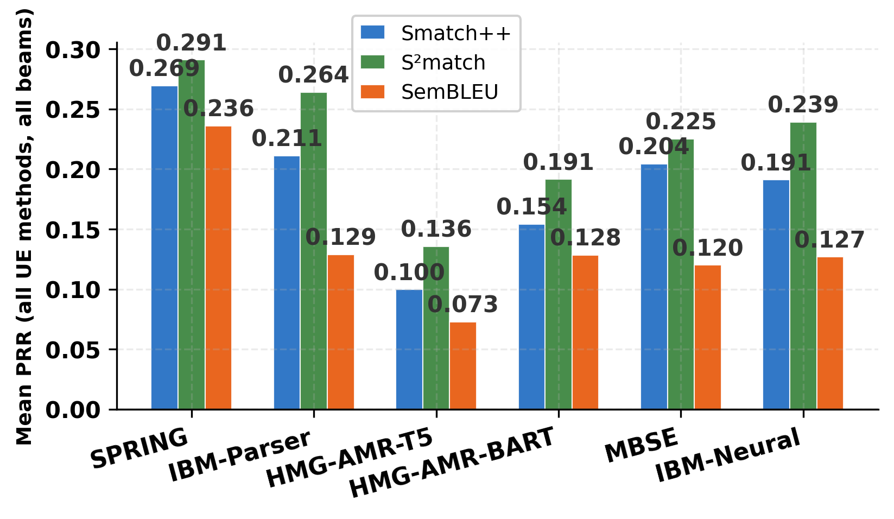

| Parser | Smatch++ | S²match | SemBLEU | Mean |
|---|---|---|---|---|
| SPRING | 0.269 | 0.291 | 0.236 | **0.265** |
| IBM-Parser | 0.211 | 0.264 | 0.129 | 0.201 |
| IBM-Neural | 0.191 | 0.239 | 0.127 | 0.186 |
| MBSE | 0.204 | 0.225 | 0.120 | 0.183 |
| HMG-AMR-BART | 0.154 | 0.191 | 0.128 | 0.158 |
| HMG-AMR-T5 | 0.100 | 0.136 | 0.073 | 0.103 |

### PRR across beam sizes (Figure 2)

Mean PRR over the 13 estimators and the three quality metrics for each beam size k.

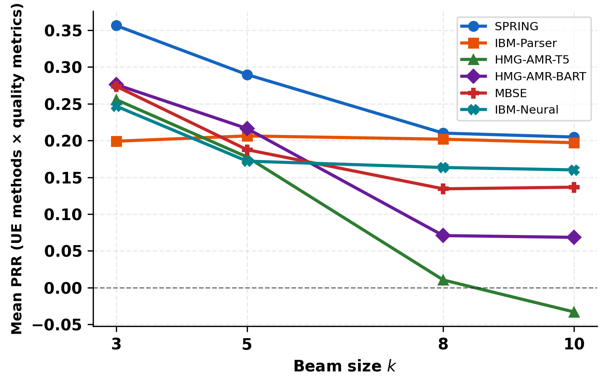

### Reliability profile at k = 10 (Figure 3)

Mean PRR of each estimator family (LexSim, EigV, DegMat, Ecc) under each quality metric.

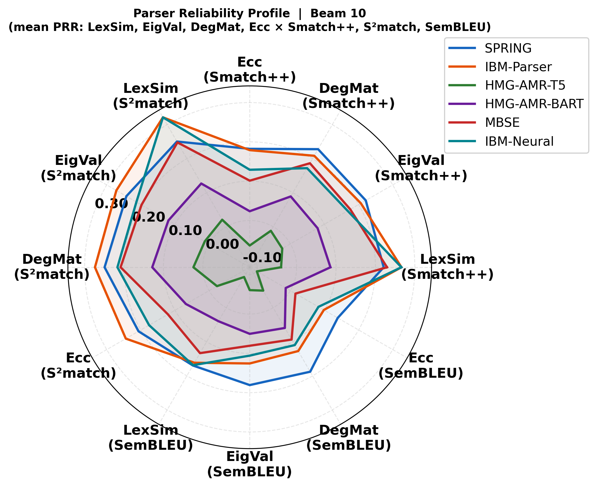

### Parsing accuracy and PRR (Figure 4)

One point per parser and beam size (6 × 4). The Spearman correlation between
top-1 Smatch and mean PRR is ρ = 0.388 under Smatch++, 0.317 under S²match and
0.360 under SemBLEU.

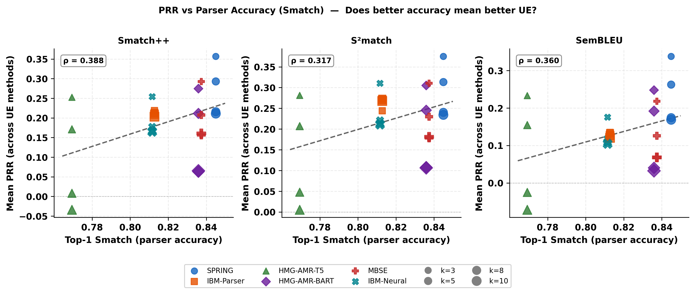

### Estimators across beam sizes (Figure 5)

Mean PRR of each estimator over the six parsers.

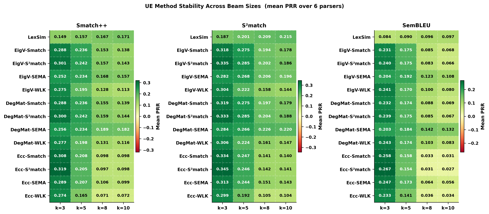

<details>
<summary><b>Table 4: PRR of every estimator at k = 10</b> (S++ = Smatch++, SB = SemBLEU)</summary>

| UE method | SPRING S++ | SPRING SB | IBM-Parser S++ | IBM-Parser SB | HMG-AMR-T5 S++ | HMG-AMR-T5 SB | HMG-AMR-BART S++ | HMG-AMR-BART SB | MBSE S++ | MBSE SB | IBM-Neural S++ | IBM-Neural SB |
|---|---|---|---|---|---|---|---|---|---|---|---|---|
| LexSim | 0.2209 | 0.1695 | 0.2660 | 0.1615 | -0.0395 | -0.0904 | 0.0858 | 0.0395 | 0.2294 | 0.1332 | 0.2659 | 0.1685 |
| EigV-Smatch | 0.1956 | 0.1421 | 0.2218 | 0.1251 | -0.0838 | -0.1199 | 0.0756 | 0.0359 | 0.1871 | 0.0802 | 0.2325 | 0.1431 |
| EigV-S2match | 0.1912 | 0.1322 | 0.2319 | 0.1232 | -0.0794 | -0.1176 | 0.0751 | 0.0330 | 0.1931 | 0.0752 | 0.2448 | 0.1473 |
| EigV-SEMA | 0.2504 | 0.2254 | 0.1919 | 0.1302 | 0.0334 | -0.0060 | 0.1080 | 0.0811 | 0.1666 | 0.0859 | 0.1945 | 0.1328 |
| EigV-WLK | 0.2469 | 0.2231 | 0.1807 | 0.1243 | 0.0348 | -0.0002 | 0.0605 | 0.0512 | 0.1555 | 0.0811 | 0.0000 | 0.0000 |
| DegMat-Smatch | 0.1971 | 0.1438 | 0.2220 | 0.1250 | -0.0826 | -0.1183 | 0.0776 | 0.0380 | 0.1878 | 0.0807 | 0.2328 | 0.1434 |
| DegMat-S2match | 0.1925 | 0.1336 | 0.2321 | 0.1234 | -0.0755 | -0.1141 | 0.0772 | 0.0351 | 0.1942 | 0.0763 | 0.2452 | 0.1477 |
| DegMat-SEMA | 0.2709 | 0.2465 | 0.1984 | 0.1353 | 0.0685 | 0.0232 | 0.1369 | 0.1091 | 0.2061 | 0.1334 | 0.2104 | 0.1472 |
| DegMat-WLK | 0.2510 | 0.2275 | 0.1814 | 0.1248 | 0.0419 | 0.0074 | 0.0643 | 0.0550 | 0.1580 | 0.0832 | 0.0000 | 0.0000 |
| Ecc-Smatch | 0.1853 | 0.1311 | 0.2051 | 0.1023 | -0.1136 | -0.1452 | 0.0268 | -0.0176 | 0.1101 | 0.0073 | 0.1768 | 0.1075 |
| Ecc-S2match | 0.1817 | 0.1222 | 0.2034 | 0.1011 | -0.1117 | -0.1477 | 0.0231 | -0.0251 | 0.1085 | 0.0035 | 0.1850 | 0.1102 |
| Ecc-SEMA | 0.1800 | 0.1506 | 0.1471 | 0.0911 | -0.0207 | -0.0547 | 0.0271 | -0.0015 | 0.1041 | 0.0385 | 0.1542 | 0.1117 |
| Ecc-WLK | 0.1821 | 0.1513 | 0.1601 | 0.0981 | -0.0089 | -0.0449 | 0.0168 | -0.0104 | 0.0824 | 0.0104 | 0.0000 | 0.0000 |

For the IBM-Neural WLK rows, see [Implementation notes](#implementation-notes).
</details>

<details>
<summary><b>More figures</b>: estimator correlations (Figures 6, 8, 11) and per-parser PRR across beam sizes (Figures 7, 9, 10)</summary>

Pairwise Spearman correlation between estimators over the 24 parser × beam results:

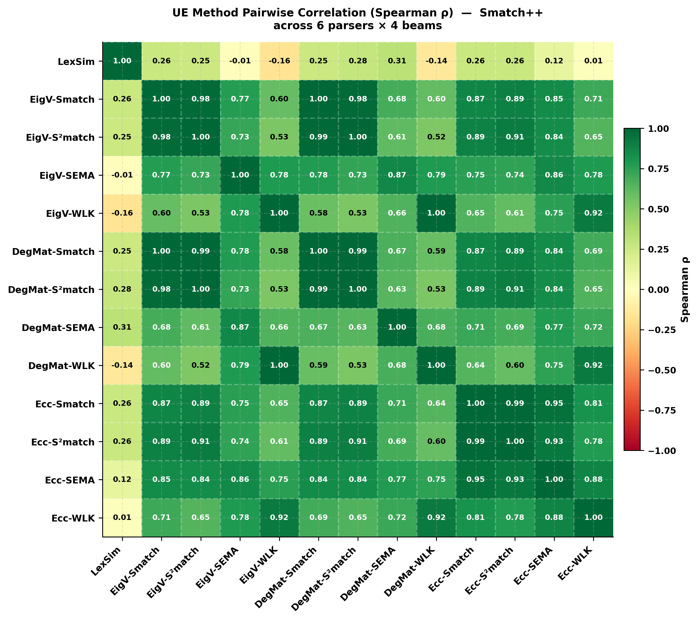
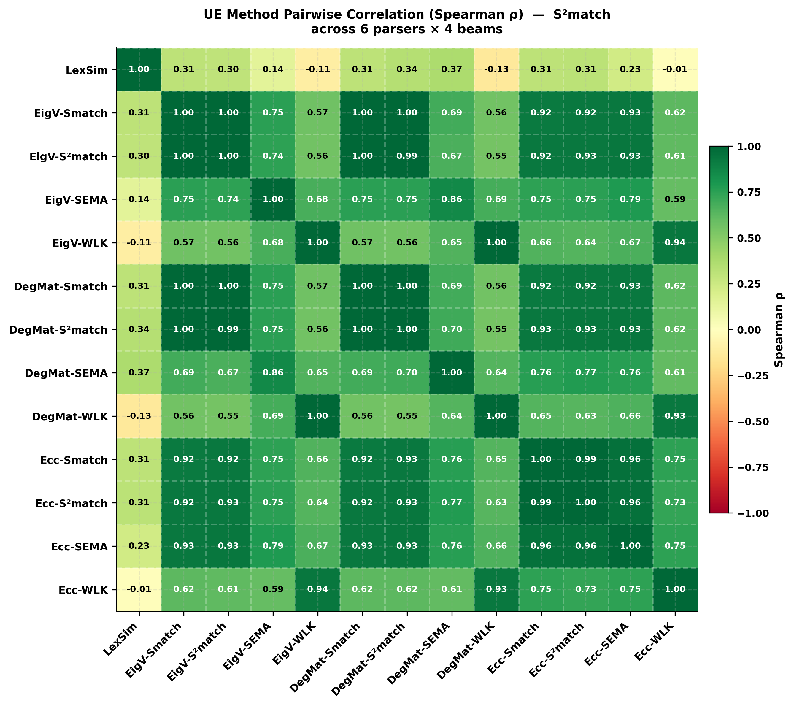
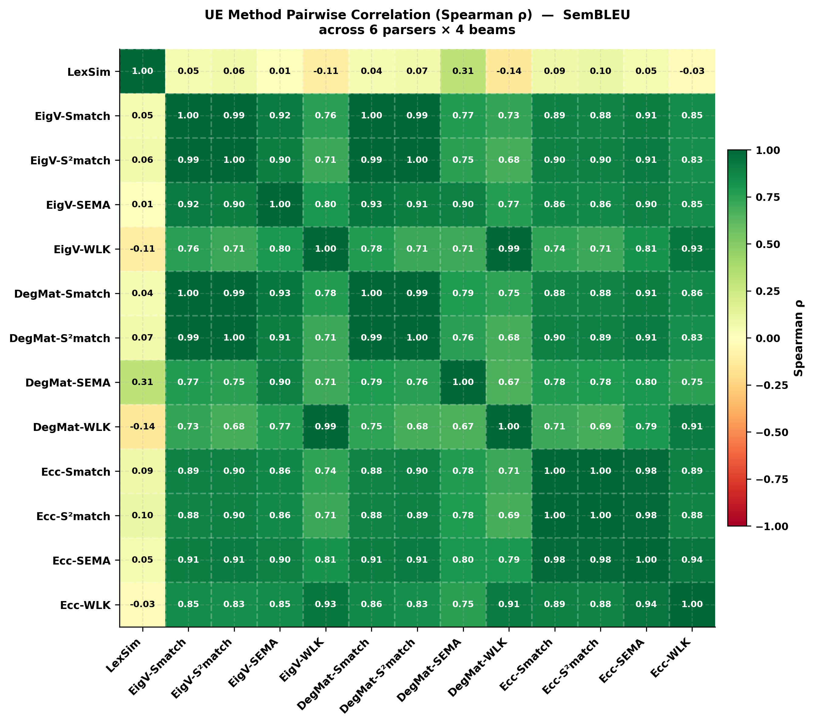

PRR per parser and estimator family across beam sizes:

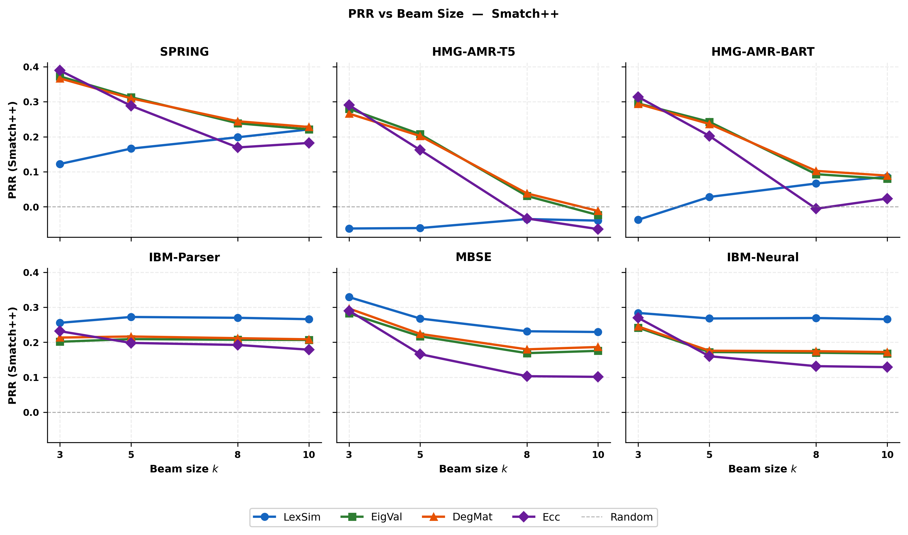
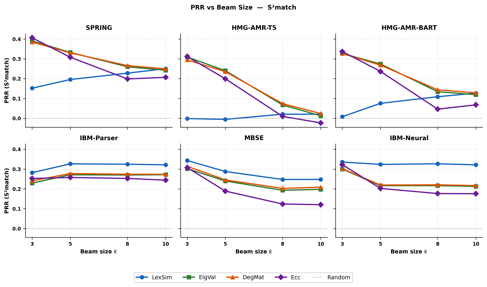
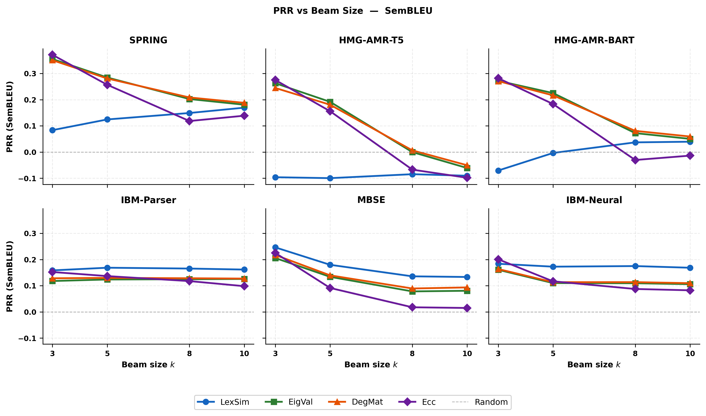
</details>


## Reproducing the paper

AMR 3.0 (LDC2020T02) is licensed by the Linguistic Data Consortium. This
repository therefore contains no sentences, gold graphs or parser outputs. It
contains the numbers from which every result of the paper is computed (see
[Released score files](#released-score-files)), which is all that is needed to
reproduce the paper.

**Installation** (Python 3.12; the versions used for the paper are pinned):

```bash
conda create -n ue_amr python=3.12
conda activate ue_amr
pip install -r requirements.txt
pip install -e similarities/smatchpp
```

**Reproduction** (CPU only, a few minutes):

```bash
python run_all.py --n_samples 0             # 24 PRR tables -> estimators/results/results_<parser>_beam<k>.csv
python scripts/check_against_paper.py      # compare every value with the paper
python scripts/paper_tables.py             # Tables 1, 3 and 4 -> estimators/results/paper_tables.md
python build_results_json.py
python paper_plots/run_all.py              # figures -> paper_figures/
```

`check_against_paper.py` reports `1224/1224` PRR values and `14/14` values of
Tables 1 and 3 identical to the paper. The PRR values are compared against
`expected/`, which holds the 24 result tables of the paper's runs.

The Smatch column of Tables 1 and 3 is read from the log of the paper's run
(`expected/top1_smatch_paper_run.log`). Smatch aligns graphs by hill climbing
with random restarts seeded from the clock, so a re-run, which is also
included, differs from the paper by up to 0.0003. The Smatch++ column is
computed from the released per-sentence quality scores.

| Paper | Script | Output |
|---|---|---|
| Tables 1, 3 and 4 | `scripts/paper_tables.py` | `estimators/results/paper_tables.md` |
| Figure 1 | `paper_plots/p01_summary_allbeams.py` | `paper_figures/summary_allbeams.pdf` |
| Figure 2 | `paper_plots/p02_prr_vs_beam_avg.py` | `paper_figures/prr_vs_beam_avg_quality.pdf` |
| Figure 3 | `paper_plots/p04_radar_lexsim.py` | `paper_figures/parser_radar_beam10_lexSim.pdf` |
| Figure 4 | `paper_plots/p05_prr_vs_smatch.py` | `paper_figures/prr_vs_smatch.pdf` |
| Figure 5 | `paper_plots/p06_ue_stability.py` | `paper_figures/ue_stability.pdf` |
| Figures 6, 8, 11 | `paper_plots/p07_ue_corr_heatmap.py` | `paper_figures/ue_corr_heatmap_{S++,S2,SB}.pdf` |
| Figures 7, 9, 10 | `paper_plots/p08_prr_vs_beam_grid.py` | `paper_figures/prr_vs_beam_grid_{SB,Spp,S2}.pdf` |

Parser names in file names: `IBM_parser` is IBM-Parser,
`amr3joint_ontowiki2_seed44` is MBSE and `ibm_amr3.0_neur_al` is IBM-Neural.


## Released score files

The score files are in `estimators/results/cache/`. They contain only numbers:
one row per test sentence, in the order of that parser's k-best files
(`sent_0000` to `sent_1897`; the order differs between parsers).

| File | Content |
|---|---|
| `<parser>_beam<k>_<sim>_n1898.npz` | `matrix` (1898, k, k): pairwise similarity of the k candidates, for `<sim>` ∈ {smatch, smatchpp, s2match, sema, wlk} |
| `<parser>_beam<k>_qual_<q>_n1898.npz` | `scores` (1898,): quality of the top-1 candidate against the gold graph, for `<q>` ∈ {S++, S2, SB} |
| `<parser>_beam<k>_ue_n1898.npz` | the 17 uncertainty scores (1898,) of the runs, one array per estimator |
| `<parser>_beam<k>_ue_LexicalSimilarity_n1898.npz` | `scores` (1898,): LexSim, the only estimator computed from the graph strings |
| `<parser>_beam<k>_order_n1898.npz` | sort order of every vector the PRR computation sorts (see [Implementation notes](#implementation-notes)) |
| `<parser>_beam3_top1_smatch_n<N>.npz` | `scores`: per-sentence Smatch of the top-1 candidate, re-run (Tables 1 and 3) |

Without k-best data, `run_all.py` reads the uncertainty and quality scores from
these files and computes PRR. With `--recompute_ue`, it recomputes the
graph-based estimators (EigV, DegMat, Ecc) from the similarity matrices
instead. The eigen-decompositions behind EigV and Ecc differ between CPUs in
the last bits, which can change the order of tied scores and, for Ecc, move an
eigenvalue across its 0.9 threshold. On the Intel AVX-512 CPUs we tested, the
recomputed scores reproduce the paper exactly; on AMD CPUs without AVX-512, a
few values differ.


## Recomputing the scores from AMR 3.0

With an LDC licence for AMR 3.0, all score files can be rebuilt from scratch.
The full procedure is described in [`data/README.md`](data/README.md):

1. Place your copy of AMR 3.0 in [`data/AMR3.0/`](data/AMR3.0/README.md) and
   prepare the gold test graphs and sentences:

   ```bash
   python scripts/prepare_data.py gold
   ```

2. Generate the k-best candidates with each parser's official code and
   checkpoint, using the export scripts in [`kbest_generation/`](kbest_generation/README.md),
   and attach the gold graphs with `kbest_generation/fix_gold_alignment.py`.

3. Check the data, including the sentence order of the paper's runs
   (`data/sentence_order.json`, which stores hashed AMR ids only):

   ```bash
   python scripts/prepare_data.py check
   ```

4. Download the GloVe vectors for S²match (`glove.6B.100d.txt` from
   https://nlp.stanford.edu/projects/glove/) into
   `similarities/amr-metric-suite/vectors/`, and compute the scores into a new
   cache directory:

   ```bash
   python run_all.py --n_samples 10 --parsers SPRING --beams 3 --cache_dir my_cache   # quick test
   python run_all.py --n_samples 0 --data_dir data/k_top_AMR_parsers --cache_dir my_cache --tie_order numpy --recompute_ue
   ```

Recomputed scores can differ slightly from the released ones, because several
of the underlying tools are not deterministic: Smatch and S²match use random
restarts seeded from the clock, Smatch++ with its default solver (a hill
climber) uses unseeded random restarts, and WLK depends on Python's hash
randomisation (`PYTHONHASHSEED`). Beam search on a GPU is not bit-reproducible
either, and the order of tied scores depends on the CPU. The released score
files contain the values of the paper's runs.

**LLM baselines (Table 3).** `run_llm_all.py` and `llm_parsers/` generate AMR
graphs with Qwen3 and Ministral (three fixed few-shot examples, temperature
0.7) and score them. The Hugging Face cache path in `llm_parsers/llm_parser.py`
and the job template in `run_llm_all.py` refer to our cluster and need to be
adjusted.

`scripts/export_scores.py` is the script the authors used to write the
uncertainty-score, sort-order and top-1 Smatch files. It writes them only for
parser and beam combinations whose 51 PRR values all equal `expected/`.


## Implementation notes

**PRR.** `compute_prr` in `estimators/pipeline.py` computes
PRR = (AUCPR_unc − AUCPR_random) / (AUCPR_oracle − AUCPR_random). The area
under the prediction-rejection curve is that of `PredictionRejectionArea` in
lm-polygraph 0.7.0: quality is min-max normalised, sentences are sorted by
increasing uncertainty, and the most uncertain ones are rejected first. The
oracle uses −q as uncertainty, and the random baseline assigns the same
uncertainty (0.0) to every sentence.

**Tie order.** The area depends on the order of sentences with equal
uncertainty. Ties are frequent (for example, when all k candidates are
identical), and the random baseline consists of ties only. `np.argsort` is not
a stable sort, and the order it gives to ties depends on the CPU's SIMD sort
routine. The `order` files store the sort order of every vector on a machine
that reproduces the paper's runs; `run_all.py` uses them by default
(`--tie_order original`), so the paper's values are obtained on any machine. A
stored order is used only if it sorts the vector it belongs to; otherwise
`np.argsort` is used. With `--tie_order numpy`, `np.argsort` is always used.

**Behaviour kept from the paper's runs.** The following behaviours of the
code that produced the paper are kept, so that its results are reproduced
exactly:

- The Smatch, S²match and WLK wrappers score pairs in batches through a
  subprocess, and a failed subprocess scores every pair of its batch 0.0; the
  code now prints a warning when this happens. For IBM-Neural at k = 5, 8 and
  10, WLK failed: one candidate graph has an empty concept, which makes the
  Smatch++ standardiser used by WLK raise an `IndexError`. All WLK
  similarities of these runs are therefore 0, and the three WLK-based
  estimators have a PRR of 0.0000 for IBM-Neural at these beam sizes (Table 4).
- The step that removes comment lines and `~N` alignment tags from the
  candidate graphs was added to the pipeline between the runs for SPRING and
  HMG-AMR, which used the graphs as stored, and the runs for the three IBM
  parsers, which used cleaned graphs. `load_data` applies it per parser in the
  same way (`UNCLEANED_IN_PAPER_RUNS`). Only LexSim depends on it, as the
  metric wrappers drop comment lines themselves.
- In the paper's runs, the last SPRING sentence (`nw.chtb_0325.10`) carries
  the gold graph of another sentence; see [`data/README.md`](data/README.md).


## Repository structure

```
run_all.py                  PRR pipeline for all parsers and beam sizes
estimators/pipeline.py      data loading, similarity matrices, uncertainty estimators, quality, PRR
estimators/metrics/         Smatch, Smatch++, S²match, SEMA and WLK wrappers
estimators/results/cache/   released score files
expected/                   result tables of the paper's runs and the Table 1/3 Smatch log
scripts/                    paper tables, comparison with the paper, data preparation, score export
paper_plots/                figure scripts
docs/figures/               figures shown in this README
data/                       place for your own copy of AMR 3.0 (not included)
kbest_generation/           k-best export scripts for the parsers' repositories
run_llm_all.py, llm_parsers/   LLM baselines (Table 3)
similarities/               third-party metric code and the SemBLEU wrapper
slurm/                      job scripts used on our cluster
```


## Third-party code

The metric implementations in `similarities/` are taken from the following
repositories.

| Directory | Source (commit) | Licence | Local change |
|---|---|---|---|
| `amr-metric-suite/` | [flipz357/amr-metric-suite](https://github.com/flipz357/amr-metric-suite) (711a231) | MIT | none (unused Python 2 code removed) |
| `smatchpp/` | [flipz357/smatchpp](https://github.com/flipz357/smatchpp) (81317b6) | GPL-3.0 | `preprocess.py`: alias `GenericStandardizer` = `AMRStandardizer`, imported by WLK |
| `sema/` | [rafaelanchieta/sema](https://github.com/rafaelanchieta/sema) (0ede9e0) | MIT | none |
| `sembleu/` | [freesunshine0316/sembleu](https://github.com/freesunshine0316/sembleu) (69ff2d4) | none stated | `src/bleu_score.py`: `Fraction(..., _normalize=False)` replaced by `Fraction(...)`, as Python 3.12 no longer accepts the argument; returns 0.0 when no n-gram order has matches |
| `weisfeiler-leman-amr-metrics/` | [flipz357/weisfeiler-leman-amr-metrics](https://github.com/flipz357/weisfeiler-leman-amr-metrics) (51624e2) | MIT | none (unused Wasserstein scripts removed) |

The uncertainty estimators and the prediction-rejection area are those of
[lm-polygraph](https://github.com/IINemo/lm-polygraph) 0.7.0.


## Citation

```bibtex
@inproceedings{kumar-etal-2026-reliable,
    title = "How Reliable are {AMR} Parser Outputs? Uncertainty Estimation for {AMR} Parsing",
    author = "Kumar, Anuj  and
      Ozaki, Shintaro  and
      Prasad, Yamuna  and
      Hayashi, Katsuhiko  and
      Kamigaito, Hidetaka  and
      Watanabe, Taro",
    editor = "Lee, Hung-Yi  and
      Dev, Sunipa  and
      Li, Jessy  and
      Elliott, Desmond",
    booktitle = "Proceedings of the 2026 Conference on Empirical Methods in Natural Language Processing",
    month = oct,
    year = "2026",
    address = "Budapest, Hungary",
    publisher = "Association for Computational Linguistics",
    url = "https://aclanthology.org/2026.emnlp-main.1365/",
    pages = "31144--31159",
    ISBN = "979-8-89176-459-0"
}
```
